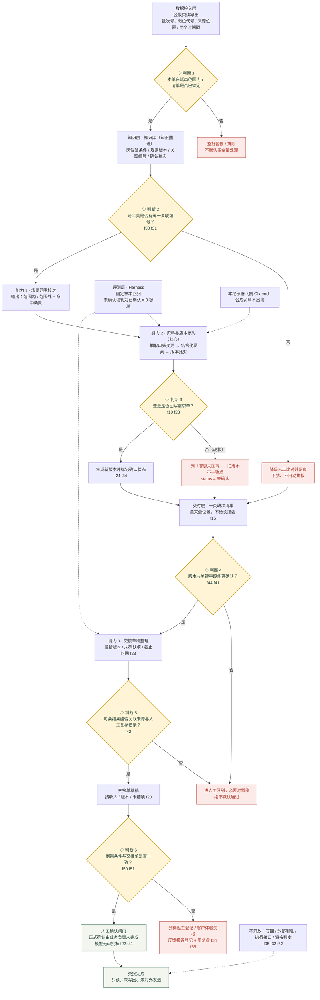

# 架构图 · 业务核对助手（方案设计）

> 竖向分层图，**菱形＝必须人工的判断点**。只画设计与控制流，不代表已实现的系统。
> 配套：`docs/技术方案.md`、`docs/提示词.md`、`docs/架构图.svg`（可打印矢量版）。

## 读图要点

1. **六个菱形全部是人工或半人工判断点**，其中判断 3、5、6 完全留给人；能力 1／2／3 只产出草稿和缺项清单。
2. **没有写回通道**：从数据接入到交接完成，全链路只读；草稿之后的正式动作由业务人员线下执行。
3. **所有「否」分支都进暂停或人工队列**，没有一条静默降级为通过（f44）。
4. 关联编号缺失（f30）不 guess，直接降级人工比对。
5. 虚线是约束与评测，不是业务数据流：Harness 绑在能力 2／3 上，本地部署绑在抽取环节。

## 与现状流程图的对应

| 现状流程图判断点 | 本架构图 | 变化 |
|---|---|---|
| 1 电话中是否修改岗位条件 | 判断 3（变更是否回写） | 从「发现异常」前移到「变更留痕」 |
| 2 变更是否回写需求单 | 判断 3 | 增加缺项清单与来源位置 |
| 3 版本与关键字段能否确认 | 判断 4 | 保持人工，明确暂停 |
| 4 跨工具是否有统一关联编号 | 判断 2 | 前移到知识层入口，缺编号即降级 |
| 5 结果能否关联来源与复核记录 | 判断 5 | 保持人工签认 |
| 6 到岗条件与交接单是否一致 | 判断 6 | 保持人工／客户现场，返工进复盘 |

## 试点边界（图外，但不可越线）

- 一个批次（f05）；30 个岗位列硬条件与待确认项、变更影响清单（f02）。
- 四周、两名骨干、每周不超四小时（f03）；范围业务负责人定、质量侧叫停、客户侧确认用途（f04）。
- 不自动决定录用或派遣资格、不向真实人员发送安排（f05、f52）。
- `f12`「80 单 / 22% 重复澄清」为虚构演练样本，不作基线。
