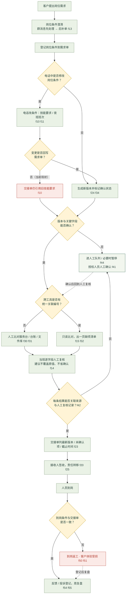

# 现状流程图 · 派遣岗位需求与到岗交接

> **竖向流程图，菱形＝必须人工的判断点**。人工现状（合成演练）；只读核对与人工交接，不代表真实授权、业务执行或客户验收。
> 编号 `fNN` = `fsg-assignment-fNN`，见 `discovery-report.md`。
> 可打印矢量版：`现状流程图.svg`（同为竖向、含菱形判断）。

## Mermaid 图（自上而下）

## 六个菱形判断点（全部必须人工）

| 判断点 | 判断内容 | 否／失败时去向 | 依据 |
| --- | --- | --- | --- |
| D | 电话中是否修改岗位条件 | 沿用已确认条件 | f10 f11 |
| F | 变更是否回写需求单 | 交接单仍引用旧技能要求（本案例断点） | f10 f23 |
| I | 版本与关键字段能否确认 | 进人工队列／暂停，授权人员确认后回流 | f44 f41 |
| K | 跨工具是否有统一关联编号 | 人工比对三套工具 | f30 f31 |
| O | 每条结果能否关联来源与人工复核记录 | 不签认，转人工 | f42 |
| S | 到岗条件与交接单是否一致 | 到岗返工、客户体验受损 | f50 f51 |

## 泳道说明（人工现状）

| 泳道 | 触发 | 输入 | 主要步骤 | 交接对象 | 异常／失败方式 |
| --- | --- | --- | --- | --- | --- |
| 业务与需求 | 客户提出岗位需求 | 岗位简报、需求变更单 | 接收需求 → 登记条件 → 澄清岗位与班次条件 → 确认人员安排 | 到岗与班次协调员 | 电话改条件未回写 f10；夜班未同步 f11 |
| 现场操作 | 条件变更或异常 | 群消息、需求单、台账 | 群消息先处理 → 事后补填 → 关键字段人工核对 → 出缺项清单 | 当班复核人、质量复核 | 回填时间 ≠ 发生时间 f13；一页缺项清单诉求 f15 |
| 数据与系统 | 只读导出请求 | 服务台／台账／文件库导出 | 字段对齐 → 比对疑似差异 → 保留原行 | 一线复核人 | 无统一关联编号 f30；缺失值与未确认值混淆 f31；版本断链 f33 |
| 交接与复核 | 到岗交接 | 交接单、确认链 | 列最新版本／未确认项／截止时间 → 人工复核 → 签认或转人工队列 | 客户现场 | 只发「已处理」f23；未确认项归责接收方 f25；无法确认版本 f44 |
| 客户现场 | 人员到岗 | 到岗确认表、反馈 | 按交接单准备 → 到岗 → 反馈／投诉登记 → 周复盘 | 服务业务负责人 | 旧口径流转导致返工 f50；口径不统一 f53 |

## 边界（图底部统一标注）

- 一个批次的需求单 f05；仅脱敏只读导出，写回／外部消息／执行接口不开放 f32。
- 不自动决定录用或派遣资格、不向真实人员发送安排 f05 f52。
- 一线可提交变更、正式确认由业务负责人完成，模型没有审批权 f22；正式结论须授权人员确认 f41。
- 四周、两名骨干、每周不超四小时 f03；范围业务负责人定、质量侧可叫停、客户侧确认用途 f04。
- f12「80 单 / 22% 重复澄清」为虚构样本，**不作基线**。

## 配套交付

- `业务挖掘.md`：9 个环节可提交结论、机会清单、基线、边界、评审依据
- `现场调研分析.md`：四来源收敛、流程拆解、失败方式、REQ-1～6、证据缺口
- `访谈记录.md/.json/.csv`：25 条问答原话
